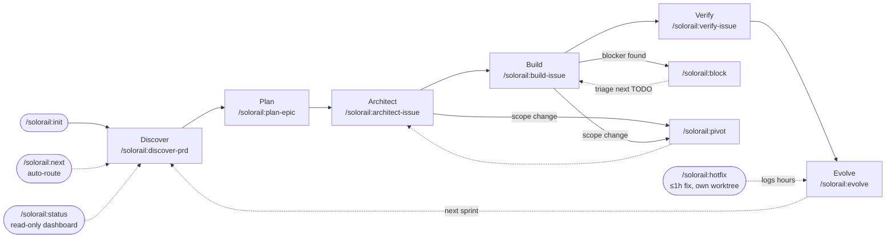

# SoloRail Command Guide

One track from idea to shipped, tested code. This guide walks through every `/solorail:*` command: what it reads, what it writes, and what it hands off to next.

## Lifecycle Diagram

---

## Discover

### `/solorail:discover-prd`
- **Reads:** `.solorail/PRD.md`, `.solorail/CONTEXT.md`, `.solorail/ROADMAP.md`
- **Writes:** `.solorail/PRD.md` (Problem, User Flows, MVP Scope Boundaries, Constraints, Epic Map; `Status: APPROVED` or `DRAFT` with `--quick`), seeds `.solorail/CONTEXT.md` Sections 1 & 3, seeds `.solorail/ROADMAP.md` with `DRAFT` Epics
- **Hands off to:** `/solorail:plan-epic E-01`

## Plan

### `/solorail:plan-epic`
- **Reads:** `.solorail/PRD.md`, `.solorail/CONTEXT.md`, `.solorail/ROADMAP.md`, active `.solorail/sprints/sprint-XX.md`
- **Writes:** `.solorail/epics/epic-XX-<slug>.md` (new, from `_TEMPLATE.md`), updates `.solorail/ROADMAP.md` Epic status to `ACTIVE`, appends `TODO` Issues to the active sprint file
- **Gate:** Aborts if `PRD.md` is still `DRAFT`/placeholder (unless `--quick`); stops if sprint capacity would be exceeded
- **Hands off to:** `/solorail:architect-issue E01-ISS-01`

## Architect

### `/solorail:architect-issue`
- **Reads:** `.solorail/CONTEXT.md`, parent `.solorail/epics/epic-XX-*.md`, active `.solorail/sprints/sprint-XX.md`
- **Writes:** `.solorail/specs/<ISSUE-ID>-spec.md` (allowlisted files, interface contract, test cases, no-go constraints), optionally a 4-line ADR in `.solorail/CONTEXT.md`, sets the Issue to `IN_PROGRESS` with `Started At` in the sprint file
- **Gate:** Aborts if another Issue is already `IN_PROGRESS`; may not modify application source code
- **Hands off to:** `/solorail:build-issue <ISSUE-ID>`

## Build

### `/solorail:build-issue`
- **Reads:** `.solorail/specs/<ISSUE-ID>-spec.md`, `.solorail/CONTEXT.md`
- **Writes:** Production code and tests within the spec's allowlisted files only (`enforce_gate.py` blocks anything else)
- **Gate:** Aborts if the spec receipt is missing or the Issue isn't `IN_PROGRESS`; warns if run directly on `main`/`master`
- **Hands off to:** `/solorail:verify-issue <ISSUE-ID>`

## Verify

### `/solorail:verify-issue`
- **Reads:** `.solorail/specs/<ISSUE-ID>-spec.md`, parent `.solorail/epics/epic-XX-*.md`, test suite + linter output, `git status --short`
- **Writes:** Sets the Issue to `DONE` with logged `Actual` hours in the sprint file, checks off met criteria in the epic file (marks the Epic `DONE` in the epic file and `.solorail/ROADMAP.md` if all its Issues are `DONE`), writes `.solorail/specs/<ISSUE-ID>-verified.json`
- **Gate:** Aborts if tests/linter fail or stray/unapproved edits exist
- **Hands off to:** the next `TODO` Issue via `/solorail:architect-issue`, or `/solorail:evolve` once the sprint is fully `DONE`/`CUT`

## Evolve

### `/solorail:evolve`
- **Reads:** Active `.solorail/sprints/sprint-XX.md`
- **Writes:** Runs `sync_metrics.py` + `eval_metrics.py` to produce `.solorail/retros/sprint-XX-telemetry.md`, adds 1–3 `Learned Guardrails` to `.solorail/CONTEXT.md` (archiving overflow past 15 into `.solorail/archive/adr-history.md`), writes `.solorail/retros/sprint-XX-retro.md`, optionally creates `.solorail/sprints/sprint-(XX+1).md` carrying over unfinished Issues
- **Gate:** Aborts if any Issue is still `IN_PROGRESS`
- **Hands off to:** `/solorail:plan-epic` for the new sprint, or back to `/solorail:discover-prd` for the next product cycle

---

## Meta & Day-2 Commands

### `/solorail:init`
- **Reads:** `git rev-list --count HEAD`, manifest files (`package.json`, `pyproject.toml`, etc.) to detect greenfield vs. brownfield
- **Writes:** Scaffolds `.solorail/` (archive, epics, retros, specs, sprints), copies templates, generates `sprint-01.md`, idempotently prepends `@.solorail/RULES.md` to `CLAUDE.md`, pre-fills `CONTEXT.md` Section 2 for brownfield repos
- **Hands off to:** `/solorail:discover-prd` (greenfield) or `/solorail:status` (brownfield)

### `/solorail:status`
- **Reads:** `.solorail/PRD.md`, `.solorail/ROADMAP.md`, latest sprint file, active epic files, `git branch`/`status`/`worktree list` — read-only, writes nothing
- **Hands off to:** whatever command its dashboard recommends next

### `/solorail:next`
- **Reads:** `.solorail/PRD.md`, `.solorail/ROADMAP.md`, active sprint file, `.solorail/specs/`
- **Writes:** Nothing itself — it determines the deterministic next stage and immediately invokes that command
- **Hands off to:** whichever of `init` / `discover-prd` / `plan-epic` / `architect-issue` / `build-issue` / `verify-issue` / `evolve` the state calls for

### `/solorail:hotfix`
- **Reads:** `.solorail/CONTEXT.md`, active `.solorail/sprints/sprint-XX.md`, current branch
- **Writes:** A regression test + surgical fix, a new `BUG-XX` row (Epic `HOTFIX`, `IN_PROGRESS` → `DONE`) in the sprint file; may isolate into `../wt-hotfix` on `hotfix/BUG-XX`
- **Hands off to:** merge/worktree cleanup, then back to whatever was in progress before the interrupt

### `/solorail:block`
- **Reads:** Active `.solorail/sprints/sprint-XX.md`
- **Writes:** Sets `<ISSUE-ID>` Status to `BLOCKED` with a `Notes` reason
- **Hands off to:** `/solorail:architect-issue` on the top 1–2 recommended `TODO` Issues

### `/solorail:pivot`
- **Reads:** `.solorail/PRD.md`, `.solorail/CONTEXT.md`, `.solorail/ROADMAP.md`, active epic files, active sprint file; checks `git status --short` first
- **Writes:** Marks obsolete Issues `CUT` (never deleted), appends new `TODO` Issues, updates epic Acceptance Criteria + Scope & Requirement Change Log, updates `PRD.md` if scope boundaries moved; warns if capacity is exceeded
- **Hands off to:** `/solorail:architect-issue` on the newly added or modified Issues
